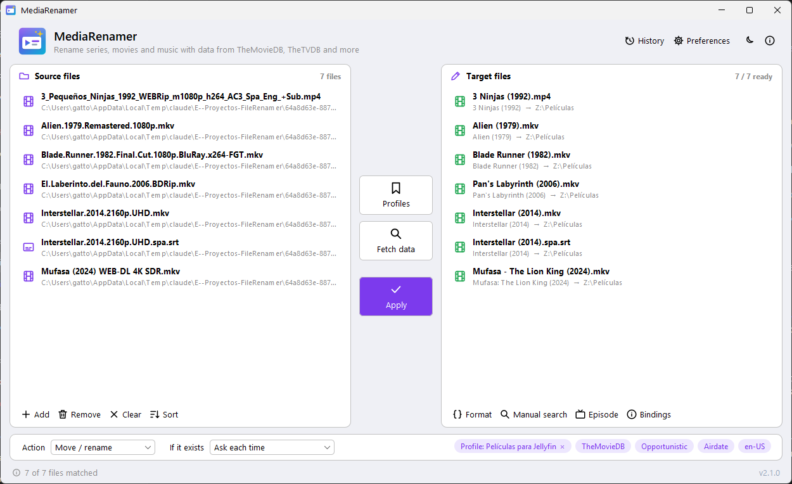
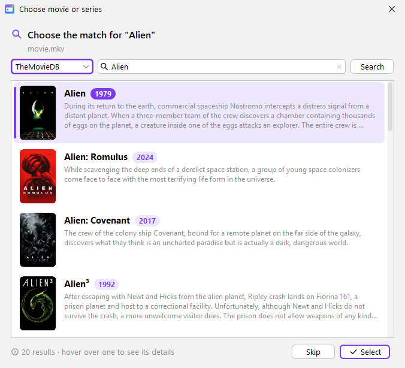
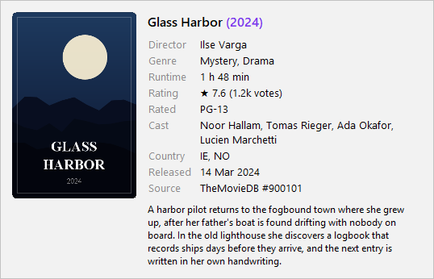
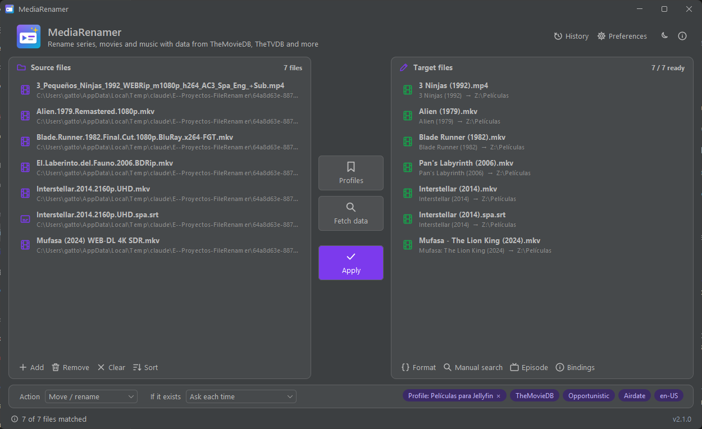

<p align="center"></p>

# MediaRenamer



Renames series, movies and music with data from online databases (TheMovieDB, TheTVDB, AniDB…)
and a format language of Groovy expressions (`{n} - {s00e00} - {t}`). Windows desktop application with a
command line.

> **Renamed in 2.0**: MediaRenamer was called *FileRenamer* up to 1.1.1. On the first start it copies the old
> preferences, encrypted API keys, profiles and history (`%APPDATA%\FileRenamer` → `%APPDATA%\MediaRenamer`), and the
> installer replaces an installed FileRenamer. See [CONFIGURATION.md](docs/CONFIGURATION.md#upgrading-from-filerenamer).

## What it does

- **Modes**: Episodes, Movies, Music and generic File.
- **Data sources**: TheMovieDB (movies and TV), TheTVDB v4, AniDB, AcoustID,
  ID3 tags (via MediaInfo), with AnimeLists and TheXEM anime mappings.
- **Detection**: series/movie name, year, `S01E02`/`1x02`/multi-episode/specials, dates,
  absolute numbering, season from the folder, "release info" cleanup (quality, codec, group, language) that keeps
  title words such as *The English Patient*.
- **Matching**: one-to-one metric cascade (`Matcher`, see [MATCHING.md](docs/MATCHING.md)), *Strict* and *Opportunistic* modes,
  Airdate/DVD/Absolute/Digital/Story/Production orders.
- **Format**: Groovy expressions, ~110 variables (`{n}`, `{y}`, `{vf}`, `{plex}`...)
  and the helper methods (`.pad()`, `.colon()`, `.space()`, `.sortName()`...). Editor with live preview and the list
  of every variable in its **ⓘ Variables** tooltip, also opened from the profile editor. Format code
  cannot run programs, write files or reach the network, and a block is stopped after 10 s (see
  [FORMAT.md](docs/FORMAT.md#security-restrictions)).
- **Actions**: move/rename, copy, keeplink, symlink and test,
  with conflict handling: skip, overwrite, keep the higher/lower quality one, the larger/smaller one,
  keep both or **ask each time** comparing quality and size. Two files of one run never replace each other.
- **Target folders** per type in Preferences (Movies, Series, Anime, Music, Other) and per profile:
  target = `<folder>/<format>`. The original extension is always kept unless the format sets another one.
- **Profiles** (folder + format + source + order + mode + language + action) in the GUI and the CLI. The data
  language is chosen from a searchable list of every language (*Español (España)*), in Preferences and in profiles.
- **Unsaved changes are kept** while moving between Preferences categories or profiles (marked in orange); closing
  asks whether to save or discard them.
- **Manual corrections**: manual search with posters, choosing the episode of a row and reordering
  the matches by dragging.
- **Name pre-check** (invalid characters, reserved names, lengths, duplicates…) with a cleanup
  suggestion, and a **cancellable modal progress** while fetching data and renaming.
- **Jellyfin and Plex**: option to scan the libraries of each server through its API after each rename, globally or
  per profile (the profile wins). Jellyfin: server URL and API Key; Plex: **Sign in…** with your Plex account in the
  browser fills the token and the server address. See [Jellyfin](docs/CONFIGURATION.md#jellyfin) and
  [Plex](docs/CONFIGURATION.md#plex).
- **Encrypted API keys** in the preferences file (Windows DPAPI), with automatic migration of old ones.
- **History**: one row per renamed file (date, source, target), in pages, with *Revert* and **CSV export**.
- **Subtitles and companions**: `Movie.spa.srt` follows its video keeping the language suffix.
- **GUI** (Swing + FlatLaf) with light/dark theme and a **CLI** (`-rename`, `-list`, `-mediainfo`…).
- **Multilingual**: interface and CLI messages in English, Spanish, French, German, Portuguese and Italian;
  chosen in **Preferences → Interface language** (defaults to the system language). See
  [CONFIGURATION.md](docs/CONFIGURATION.md#interface-language).
- **Preferences by category** (General, Data services, Target folders, Media servers, Tools) with an ⓘ on every option
  explaining what it is for.
- **Setup wizard on the first run**: interface language, the API keys of the data services (with what each one is
  for and a button to get the key) and the media servers (Jellyfin, Plex). See [docs/USAGE.md](docs/USAGE.md#first-run-setup-wizard).
- **About MediaRenamer** (ⓘ button in the header, or click the version in the status bar): version, author, license
  (opens the GNU GPL v3 text), credits, **Third-party licenses** (the license notices of the bundled libraries and
  Java runtime) and **♥ Sponsor** (opens the GitHub Sponsors page).
- **Poster search**: TMDb/TheTVDB results show poster, year, original title and
  overview; on mouse hover a card shows director/creators, cast, genres, runtime, rating…

| Search | Card on mouse hover | Dark theme |
|---|---|---|
|  |  |  |

## Download

The installer (`MediaRenamer-<version>-setup.exe`) and the portable zip of every version are on the
[Releases page](https://github.com/AeLui/MediaRenamer/releases). They are not code-signed, so Windows may warn the first
time you run them: see [Release integrity](#release-integrity).

## Windows installer and executable

```powershell
powershell -ExecutionPolicy Bypass -File scripts\build-exe.ps1
```

It produces (the version comes from `pom.xml`):

- `dist\MediaRenamer-<version>-setup.exe`: **installer**. Wizard in the app's six languages, per-user install
  without administrator rights (or for all users), Start menu shortcut, optional desktop shortcut and uninstaller.
  Installing a newer version upgrades the existing one; uninstalling keeps your preferences, keys, profiles and history.
- `dist\MediaRenamer\MediaRenamer.exe` (desktop) and `dist\MediaRenamer\MediaRenamer-cli.exe` (console), and
  `dist\MediaRenamer-<version>-windows.zip` with that folder (portable version).
- Every package carries `LICENSE.txt` (GNU GPL v3) and `THIRD-PARTY-NOTICES.txt` next to the exe and the Java
  runtime notices in `runtime\legal` (see [docs/THIRD_PARTY.md](docs/THIRD_PARTY.md)).

Everything bundles its own Java (the JDK that runs `jpackage`, so build with the latest Java 21 security update; the
script prints the bundled version): nothing needs to be installed to run it. Building the installer needs
[Inno Setup 6](https://jrsoftware.org/isinfo.php) (see [docs/DEVELOPMENT.md](docs/DEVELOPMENT.md#windows-executable-and-installer)).

## Quick start (from source)

Requirements: **Java 21** and **Maven 3.9** (see [docs/DEVELOPMENT.md](docs/DEVELOPMENT.md)).

```bash
mvn -B package
```

```bash
java -jar target/MediaRenamer.jar
```

Before using TheMovieDB/TheTVDB/AcoustID/AniDB, set your API keys in *Preferences*
(see [docs/CONFIGURATION.md](docs/CONFIGURATION.md)). **ID3** tags and **File** mode work without a key.

CLI example (test mode, does not touch the disk):

```bash
java -jar target/MediaRenamer.jar -rename "D:/Downloads" -r --db TheMovieDB::TV --format "{n}/Season {s}/{n} - {s00e00} - {t}" --action test
```

## Documentation

| Document | Content |
|---|---|
| [docs/USAGE.md](docs/USAGE.md) | User guide for the interface: buttons, corrections, name check, conflicts, language |
| [docs/ARCHITECTURE.md](docs/ARCHITECTURE.md) | Packages, data flow and main classes |
| [docs/DATA_SOURCES.md](docs/DATA_SOURCES.md) | Each integration: endpoints, keys, limits and cache |
| [docs/FORMAT.md](docs/FORMAT.md) | Format language, variables, methods and their status |
| [docs/MATCHING.md](docs/MATCHING.md) | Name detection, SxE and matching algorithm |
| [docs/CLI.md](docs/CLI.md) | Command line reference |
| [docs/CONFIGURATION.md](docs/CONFIGURATION.md) | Preferences, API keys, external tools, data files |
| [docs/DEVELOPMENT.md](docs/DEVELOPMENT.md) | Building, testing, conventions, **security standards** (mandatory for every change) and how to extend |
| [CHANGELOG.md](CHANGELOG.md) | What changed in each release (and what is coming in the next one) |
| [docs/ROADMAP.md](docs/ROADMAP.md) | Status of each feature, by version |
| [docs/THIRD_PARTY.md](docs/THIRD_PARTY.md) | Third-party components and their licenses, where the notices ship, Store listing text |
| [docs/PRIVACY.md](docs/PRIVACY.md) | Which online services are contacted, when and with what data |
| [docs/RELEASE_INTEGRITY.md](docs/RELEASE_INTEGRITY.md) | How a release is built and how to check a download (releases are not code-signed) |

## License

Copyright (C) 2026 AeLiu.

MediaRenamer is free software: you can redistribute it and/or modify it under the terms of the
**GNU General Public License version 3** (`GPL-3.0-only`), as published by the Free Software Foundation. It is
distributed in the hope that it will be useful, but **without any warranty**; see [LICENSE](LICENSE) for the full text.

Any distributed copy or modified version must stay under the GPL v3 and come with its complete source code.

**Contributions**: by submitting a pull request you agree that your contribution is licensed under the GPL v3.

## Release integrity

Releases are not code-signed. The Windows executables, the zip and the installer of each release are built from the tag
by the [Release workflow](.github/workflows/release.yml) of this repository on GitHub Actions, and GitHub publishes the
SHA-256 digest of each file; the in-app update checks that digest before installing. See
[docs/RELEASE_INTEGRITY.md](docs/RELEASE_INTEGRITY.md).

## Privacy

MediaRenamer does not collect telemetry and only contacts the online services you use, plus a check for a newer version
on GitHub at start-up (once a day at most; it can be turned off in *Preferences*): see
[docs/PRIVACY.md](docs/PRIVACY.md).

## Support the project

MediaRenamer is free. If it is useful to you, you can support its development through
[GitHub Sponsors](https://github.com/sponsors/AeLui) (the **Sponsor** button of the repository, or **♥ Sponsor** in
*About MediaRenamer*).

## Legal notice

MediaRenamer ships no API keys: each user configures their own credentials.
Respect the terms of use of each service (TMDb, TheTVDB, AniDB, AcoustID).
Third-party components and their licenses: [docs/THIRD_PARTY.md](docs/THIRD_PARTY.md) and
[THIRD-PARTY-NOTICES.txt](THIRD-PARTY-NOTICES.txt).
