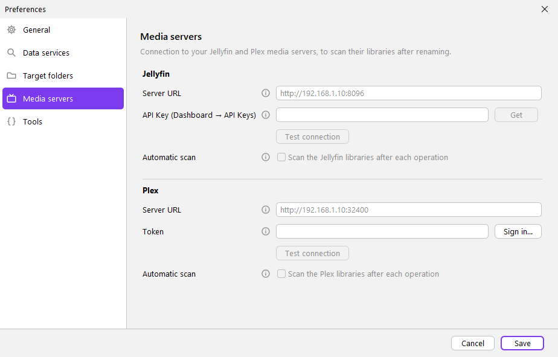

# Configuration

## Preferences file

It is created by the setup wizard on the first run of the GUI (see [USAGE.md](USAGE.md#first-run-setup-wizard)); while
it does not exist, the GUI starts with the wizard. The CLI never shows the wizard.

`%APPDATA%\MediaRenamer\settings.properties` (Linux/macOS: `~/.mediarenamer/settings.properties`).
It is edited from *Preferences* in the GUI or by hand. Each key accepts an **environment variable**
`MEDIARENAMER_<KEY>` (uppercase, non-alphanumeric → `_`) or a `-Dmediarenamer.<key>=...` property,
which take precedence over the file.

### Encrypted API keys

Since v0.7 the API keys (`apikey.tmdb`, `apikey.tvdb`, `apikey.tvdb.pin`, `apikey.acoustid`,
`jellyfin.apikey` and, since v2.3, `plex.token`) are stored **encrypted** in the file:

- **Windows**: user DPAPI (`CryptProtectData`), value `dpapi:…`. Only your Windows user on this machine
  can decrypt them: if you copy the file to another machine or user, those keys are ignored (warning in the log) and
  must be entered again in Preferences.
- **Linux/macOS**: AES-256-GCM with a random key in `secret.key` (permissions `600`) next to the file, value `aes:…`.
- **Automatic migration**: on startup, any key still in plain text (files from v0.6 or earlier, or
  written by hand) is encrypted and the file is rewritten; the other preferences do not change. To change a key use
  Preferences (or write it in plain text in the file and it will be encrypted on the next start).
- The file is written atomically (`settings.properties.tmp` → `settings.properties`).
- It does not affect environment variables or `-Dmediarenamer.…`, which are read as is.
- A version older than 0.7 does not understand `dpapi:…`: do not go back to an older version with the same file.
- Keys encrypted by FileRenamer (up to 1.1.1, another DPAPI entropy) are still read and are encrypted again with the
  MediaRenamer entropy on the first start (`Preferences: N API keys of the previous version re-encrypted…` in the log).
  FileRenamer cannot read the re-encrypted keys: its own folder keeps the old ones.

| Key | Environment variable | Use |
|---|---|---|
| `apikey.tmdb` | `MEDIARENAMER_APIKEY_TMDB` | TheMovieDB (API key v3 or token v4) |
| `apikey.tvdb` | `MEDIARENAMER_APIKEY_TVDB` | TheTVDB v4 |
| `apikey.tvdb.pin` | `MEDIARENAMER_APIKEY_TVDB_PIN` | TheTVDB subscriber PIN (optional, depending on your key type) |
| `apikey.acoustid` | `MEDIARENAMER_APIKEY_ACOUSTID` | AcoustID |
| `apikey.anidb.client` | `MEDIARENAMER_APIKEY_ANIDB_CLIENT` | Name of the HTTP client registered at AniDB |
| `apikey.anidb.clientver` | `MEDIARENAMER_APIKEY_ANIDB_CLIENTVER` | AniDB client version (default 1) |
| `ui.language` | `MEDIARENAMER_UI_LANGUAGE` | Interface and CLI language: `en`, `es`, `fr`, `de`, `pt`, `it`. Empty = the system's (English if it is not one of those) |
| `rename.language` | | Data language (`es-ES`), chosen from the list in Preferences → Data services. Empty = system language |
| `rename.episode.order` | | Default episode order |
| `rename.match.mode` | | `Strict` or `Opportunistic` |
| `rename.action`, `rename.conflict` | | GUI "Action" and "If it exists" (default `MOVE` and `ASK` = ask each time) |
| `dest.movies`, `dest.series`, `dest.anime`, `dest.music`, `dest.other` | | Default target folder per type (target = folder/format). Empty = the file's folder. Empty `dest.anime` = `dest.series` |
| `rename.format.episode/movie/music/file` | | Format of each mode |
| `rename.format.recent` | | Recent formats (separated by line breaks) |
| `rename.db.episode/movie/music` | | Last source chosen per mode |
| `jellyfin.url` | `MEDIARENAMER_JELLYFIN_URL` | Jellyfin server URL (`http://nas:8096`; `http://` is assumed if missing) |
| `jellyfin.apikey` | `MEDIARENAMER_JELLYFIN_APIKEY` | Jellyfin API Key (*Dashboard → API Keys*) |
| `jellyfin.scan` | | `true` = *Scan the Jellyfin libraries after each operation* (default `false`). A profile can change it |
| `plex.url` | `MEDIARENAMER_PLEX_URL` | Plex Media Server URL (`http://nas:32400`; without scheme and port, `http://` and `:32400` are added) |
| `plex.token` | `MEDIARENAMER_PLEX_TOKEN` | Plex token (filled by **Sign in…**) |
| `plex.scan` | | `true` = *Scan the Plex libraries after each operation* (default `false`). A profile can change it |
| `plex.clientid` | | Random id of this installation for plex.tv (`X-Plex-Client-Identifier`), created on the first sign-in. Not a secret |
| `tool.mediainfo` | `MEDIARENAMER_TOOL_MEDIAINFO` | Folder or path of `MediaInfo.dll` / `MediaInfo.exe` |
| `tool.fpcalc` | `MEDIARENAMER_TOOL_FPCALC` | Folder or path of `fpcalc.exe` |
| `ui.dark` | | Dark theme |

## Interface language

It is changed in **Preferences → Interface → Interface language** (key `ui.language`). It affects the window, the
dialogs, the status bar and error messages, Swing's own buttons (Yes/No, file chooser) and
the CLI output. *Automatic* uses the system language if it is one of the six available ones, otherwise English.
For the CLI it can also be forced with the environment variable `MEDIARENAMER_UI_LANGUAGE=de`.

The texts are in `src/main/resources/com/mediarenamer/i18n/messages*.properties` (see
[DEVELOPMENT.md](DEVELOPMENT.md#texts-and-languages)). Format variables (`{n}`, `{s00e00}`...), the names of
the data sources, of the orders (`Airdate`, `DVD`...) and the CLI options are not translated.

## Getting the API keys

| Service | Where | Cost |
|---|---|---|
| TheMovieDB | https://www.themoviedb.org/settings/api | free (personal use) |
| TheTVDB | https://thetvdb.com/api-information | free with attribution / paid depending on use |
| AcoustID | https://acoustid.org/new-application | free |
| AniDB | https://anidb.net/software/add (register an HTTP client) | free, very limited use |

> MediaRenamer ships **no** API keys: each user registers their own, as each service's terms require.

## Jellyfin

In **Preferences → Media servers** (Jellyfin section) you set the server URL and an API Key, and enable
*Scan the Jellyfin libraries after each operation*. The checkbox can only be ticked when the URL and the API Key
are filled in. **Test connection** checks the typed values (without saving them) with `GET /System/Info` and
shows the server name and version.

Each **profile** has the same option, ***(don't change)* by default**: the Preferences setting is used; *Yes* or *No*
**override the general preference**. In the profile editor the option can only
be changed with Jellyfin configured in Preferences (otherwise it is shown disabled and there is never a scan).

- The API Key is created in Jellyfin in *Dashboard → Advanced → API Keys → +*. With the server URL written, the **Get**
  button opens that page directly: it asks the server for its version (`GET /System/Info/Public`, no key needed) and
  opens `…/web/#/dashboard/keys` (Jellyfin 10.9 and later) or `…/web/index.html#!/apikeys.html` (older versions); if
  the server does not answer, the web interface root. The 10.8 route has not been tried against a real server.
- The scan is `POST /Library/Refresh` (the same as *Scan All Libraries* in the dashboard), with the
  key in the header `Authorization: MediaBrowser Token="…"`; it never goes in the URL or the log.
- It is only triggered if the option (the active profile's or, if it does not set it, the general one) is enabled **and**
  there is a URL and a key; not with the *Test* action, nor if the process was cancelled, nor if no file was renamed.
  Jellyfin answers right away and the scan continues on the server.
- If it fails (server down, wrong key…), the files stay renamed and a warning is shown.
- **Plain http**: without a scheme `http://` is assumed (usual on a local network). If the URL is `http://` and the
  server does not look local (not `localhost`, a private IP such as `192.168.x.x`/`10.x.x.x`, a name without a dot or a
  `.local`/`.lan`/`.home.arpa` domain), Preferences shows a warning and the log too: the API Key would travel
  unencrypted over the internet. Use `https://` for remote servers.

## Plex

In **Preferences → Media servers**, below Jellyfin and a separator, the Plex section has the server URL, the token,
**Test connection** and *Scan the Plex libraries after each operation*. As with Jellyfin, the checkbox needs the URL
and the token, each **profile** has its own Plex option (*(don't change)* = Preferences; *Yes*/*No* override it; disabled while
Plex is not configured), and Plex and Jellyfin are independent: one profile can scan both, one or none.

**Sign in…** gets the token without looking for it by hand, with the official plex.tv PIN sign-in for applications:

1. MediaRenamer asks plex.tv for a PIN (`POST https://plex.tv/api/v2/pins?strong=true`).
2. The browser opens `https://app.plex.tv/auth#?clientID=…&code=…`: you sign in **on plex.tv** (your password is never
   typed in MediaRenamer) and allow *MediaRenamer*. The button becomes **Cancel** while it waits; closing the window
   also cancels. If no browser can be opened, the address is shown to copy it.
3. MediaRenamer polls the PIN every 2 s until it carries the token or expires (plex.tv sets the expiry; MediaRenamer waits 30 min at most).
4. It asks for your servers (`GET https://clients.plex.tv/api/v2/resources`) and keeps only **your own** ones (not
   the shared ones). With several, it uses the one whose address is already in the URL field or asks which one.
   The token stored is that server's access token.
5. If the URL is empty, it tries the server's addresses, best first (local `https://…plex.direct`, local
   `http://ip:port`, remote `https://`; relays never) with `GET /identity` (no token, 4 s each, at most 6) and writes
   the first that answers. If none answers from this PC, the first one is written anyway and the status says so.

Nothing is saved until **Save**. **Test connection** checks the typed values with `GET /` and shows the server name and
version. MediaRenamer appears in your Plex account under *Authorized Devices*; remove it there to revoke the token.
You can also paste a token by hand (for example one taken from *View XML* in Plex Web).

- The scan lists the libraries (`GET /library/sections`) and asks each one to scan
  (`GET /library/sections/{key}/refresh`, the same as *Scan Library Files*); Plex answers right away and the scan
  continues on the server. Only numeric library keys are used.
- Every request asks for JSON (`Accept: application/json`), so no XML from the server is parsed. The token goes in the
  `X-Plex-Token` header, never in the URL; the logs hide `code=` and `X-Plex-Token=` values.
- Values that come from plex.tv are validated: tokens and PIN codes must be short alphanumeric strings, server
  addresses must be `http`/`https` URLs with a host and without user info, query or fragment.
- When it is triggered, the failures and the plain-http warning work as for Jellyfin (`plex.insecure`: http to a
  server that does not look local sends the token unencrypted).
- Tested against a simulated server (PIN sign-in, servers, address probing, test, scan). **Not yet tested against a
  real Plex Media Server and plex.tv.**

## External tools

- **MediaInfo** (technical variables and ID3 mode): the 64-bit `MediaInfo.dll` is used. It is found automatically if
  MediaInfo is installed (`C:\Program Files\MediaInfo`), in the `lib` folder next to `MediaRenamer.exe` (or the jar)
  or on the `PATH`; otherwise set `tool.mediainfo`.
- **fpcalc** (AcoustID): from https://acoustid.org/chromaprint; searched in `tool.fpcalc` (the program or the folder
  that holds it), the `lib` folder next to `MediaRenamer.exe` (or the jar), `C:\Program Files\Chromaprint` and the `PATH`.
- In **Preferences → Tools** each path has a **Choose…** button (a file chooser limited to the tool's file names) and a
  line that checks the typed path: the tool's own file or a folder holding it, absolute, and existing. Empty shows
  where the automatic search finds the tool. Only names and existence are checked: the tool is not run from there.
- Tools are **never** looked for relative to the current folder (`./lib`, relative `PATH` entries): a `MediaInfo.dll`
  or `fpcalc.exe` left in a downloaded or shared folder from which the CLI is run is not loaded. On Windows the
  generic system library search is not used either. A run of the MediaInfo CLI is stopped after 2 minutes and one of
  fpcalc after 1 minute.

## HTTPS certificates

HTTPS certificates are trusted if **either** the root certificates bundled with the app's Java (`cacerts`) **or**
(on Windows) the system store (`Windows-ROOT`) trust them (`app.TrustStores`, installed in `Main`). Both are needed:

- `cacerts` alone fails when an antivirus or a corporate proxy inspects HTTPS with its own root certificate, which is
  only in the Windows store (it happens on the development machine).
- `Windows-ROOT` alone fails on a freshly installed Windows: the store is almost empty because Windows downloads the
  roots on demand, and Java never triggers that download (until v0.9.0 every request failed there with
  `PKIX path building failed`; found by the installer test in Windows Sandbox).

To force a specific store, pass `-Djavax.net.ssl.trustStore=...` or `-Djavax.net.ssl.trustStoreType=...` at startup:
then the combined trust is not installed.

## Data files

| File | Content |
|---|---|
| `%APPDATA%\MediaRenamer\settings.properties` | Preferences |
| `%APPDATA%\MediaRenamer\history.xml` | History (for `{original}` and *Revert*) |
| `%APPDATA%\MediaRenamer\presets.json` | Profiles (JSON list: `id`, `name`, `format`, `database`, `sortOrder`, `matchMode`, `language`, `outputFolder`, `jellyfinScan` and `plexScan`: `true`/`false`, absent = general preference). The media type is the one of `database`; an `action` field from before 2.5 is ignored |
| `secret.key` | Linux/macOS only: AES key to encrypt the API keys (does not exist on Windows: DPAPI is used) |
| `%APPDATA%\MediaRenamer\cache\` | Cached HTTP responses (safe to delete). Responses older than 31 days (the longest expiry) are removed in the background at every start |
| `%APPDATA%\FileRenamer\` | Data of FileRenamer (up to 1.1.1): copied once, then never read or modified again |

## Upgrading from FileRenamer

The application was called **FileRenamer** up to 1.1.1. On the first start of MediaRenamer (GUI or CLI):

- If `%APPDATA%\MediaRenamer` (Linux/macOS: `~/.mediarenamer`) does not exist and `%APPDATA%\FileRenamer`
  (`~/.filerenamer`) does, the whole folder is **copied**: preferences, encrypted API keys, profiles, history and cache.
  The copy goes to `MediaRenamer.migrating` and is renamed at the end, so an interrupted copy is repeated on the next
  start. The old folder is kept untouched as a backup and can be deleted by hand once everything works.
- If `%APPDATA%\MediaRenamer` already exists nothing is copied (and, with preferences, the setup wizard is not shown).
- The API keys are encrypted again with the new DPAPI entropy (see [Encrypted API keys](#encrypted-api-keys)).
- With `-Dmediarenamer.data=<folder>` there is no migration: that folder is used as is.
- Not migrated: environment variables (`FILERENAMER_*` → rename them to `MEDIARENAMER_*`) and `-Dfilerenamer.*`
  properties (→ `-Dmediarenamer.*`).

The installer (`MediaRenamer-<version>-setup.exe`) silently uninstalls an installed FileRenamer (per user or for all
users; for the latter Windows asks for administrator rights) before installing MediaRenamer, so the old program folder
and its shortcuts disappear. FileRenamer's uninstaller never removes `%APPDATA%\FileRenamer`.
