# User guide

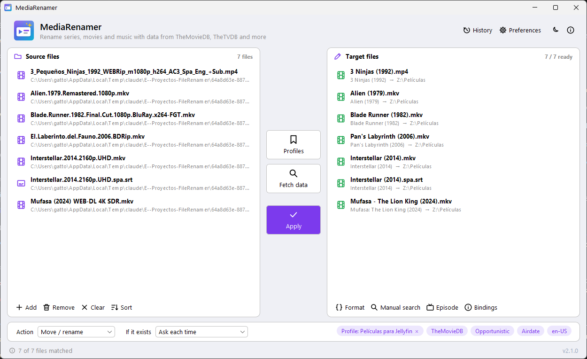

The labels below are the English ones; the interface can be shown in other languages
(see [Interface language](#interface-language)).

## First run: setup wizard

The first time MediaRenamer is opened (when there is no preferences file yet) a short wizard appears:

1. **Language** of the interface (the system language is preselected). Choosing one switches the wizard to it at once.
2. **Data services**: the API keys of TheMovieDB, TheTVDB, OMDb, AcoustID and AniDB. The ⓘ icon next to each one
   explains what it is used for, and **Get** opens the page where the key is requested. All are optional:
   ID3 tags (music) and File mode work without a key.
3. **Media servers** (optional): **Jellyfin** (server URL and API Key; with the URL written, **Get** opens the API
   keys page of your server) and, below a separator, **Plex** (server URL and token; **Sign in…** fills both for you,
   see [CONFIGURATION.md](CONFIGURATION.md#plex)). Each one has **Test connection** and the option to scan its
   libraries after each rename. The page scrolls if it does not fit.

**Finish** saves everything; **Skip setup** (or closing the window) saves only the language. Everything can be
changed later in **Preferences**, which shows the same ⓘ icons. To see the wizard again, delete (or rename)
`%APPDATA%\MediaRenamer\settings.properties`.

| Language | Data services | Media servers |
|---|---|---|
| 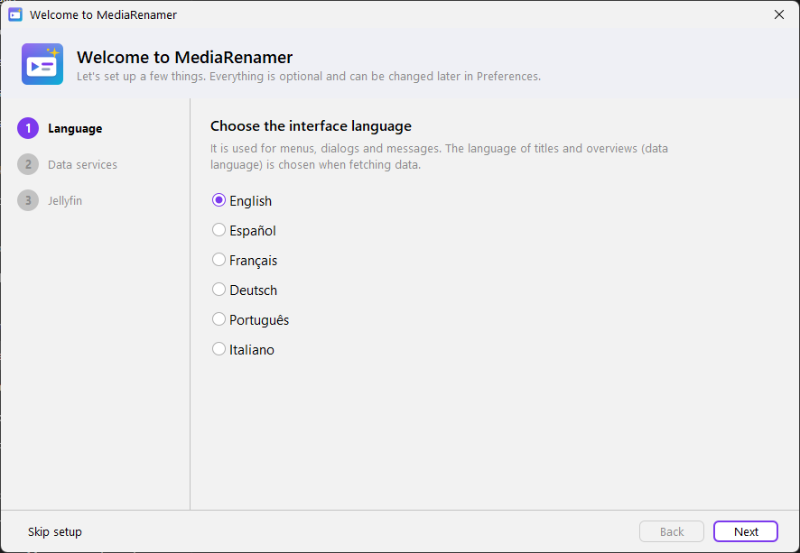 | 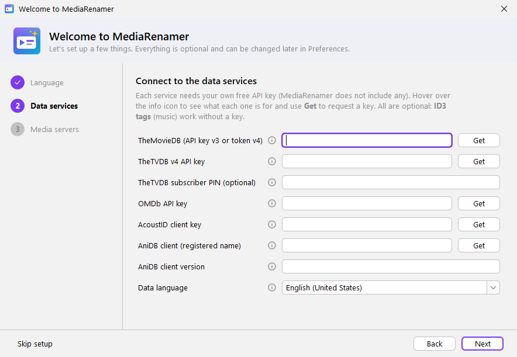 | 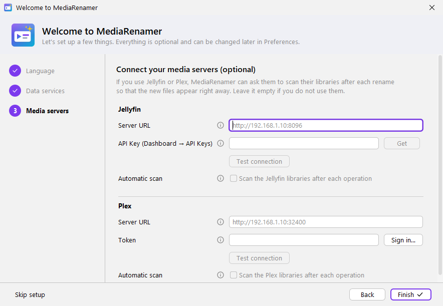 |

## Basic flow

1. **Add files**: drag files or folders onto *Source files*, or press **Add**
   (or click the empty area). Folders are walked including their subfolders. If no row was selected, the first one
   is selected in both lists; a selection you made is kept when you add more files or fetch data.
2. **Identify**: choose one of these two options.
   - **Profiles**: applies a saved profile. It sets the target folder, format, data source, episode
     order, mode, language, action and, if specified, whether Jellyfin and/or Plex are scanned at the end; then it
     fetches the data.
   - **Fetch data**: choose the source (*Movies*: TheMovieDB, OMDb; *Series*: TheMovieDB TV, TheTVDB, AniDB;
     *Music*; *File*). The same menu changes the matching mode
     (strict/opportunistic), the episode order and the data language. Choosing a source here stops using the active profile.
3. **Review** the *Target files* list and fix whatever is needed (see below).
4. Choose the **Action** and **If it exists** options and press **Apply** (✓).
   Actions: *Move / rename*, *Copy*, *Keep link* (move and leave a symbolic link), *Symbolic link* and *Test*
   (nothing is touched).

While data is being fetched or files renamed, a layer dims the window and blocks the application. It shows the
progress (file *n* of *N* and its name) and a **Cancel** button (or the Esc key).

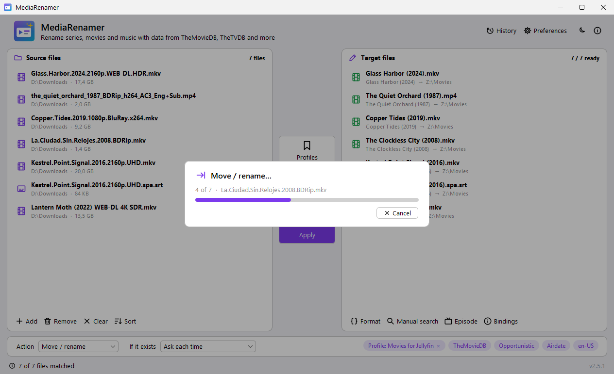

Cancelling finishes the current file and stops. Whatever was already renamed stays in the **History** and can be undone (see [History](#history)).

If *Scan the Jellyfin libraries after each operation* or *Scan the Plex libraries after each operation* is enabled
(in **Preferences → Media servers**, or in the active profile, which takes precedence), once all files have been moved
the bar moves on to an extra step, **Scanning libraries…**, which asks each enabled server to scan its libraries (see
[CONFIGURATION.md](CONFIGURATION.md#jellyfin) and [Plex](CONFIGURATION.md#plex)). Jellyfin goes first, then Plex.
This step cannot be cancelled and lasts as long as the servers take to accept the request; if one fails, the other is
still asked, and a warning per failed server is shown without undoing anything.

## Preferences

**Preferences** (top right) groups the options by category in a sidebar; one **Save** applies to all of them, and the
last category opened is shown again:

| Category | Options |
|---|---|
| General | interface language, dark theme |
| Data services | API keys (with **Get** to request each one) and the data language |
| Target folders | default folder per type (Movies, Series, Anime, Music, Other) |
| Media servers | **Jellyfin**: server URL, API Key (**Get** opens the API keys page of your server once the URL is written), **Test connection**, automatic scan. **Plex** (below a separator): server URL, token (**Sign in…** gets it from plex.tv), **Test connection**, automatic scan |
| Tools | MediaInfo and fpcalc paths, each with **Choose…** |

Every option has an **ⓘ** icon: hover over it (or over the field) to see what it is for. The *Data services* and
*Media servers* pages are the same ones the setup wizard shows.

- **Data language**: a list of every language and language-country pair (*Español (España)*, *English (United
  States)*…), shown in the interface language with its tag on the side. Type to filter it by name or tag (`espa`,
  `es-MX`; case and accents do not matter) and press Enter or leave the field to pick the match; text that matches
  nothing goes back to the previous value. The first entry, *Automatic*, uses the system language.
- **Tools**: empty = the tool is searched automatically, and the line under the field says where it was found.
  **Choose…** opens a file chooser limited to the tool's files (`MediaInfo.dll`/`MediaInfo.exe`, `fpcalc.exe`); a
  folder that holds them can also be typed. The line checks the path as you type: ✓ found, the file does not exist, or
  it is not that tool. The tool is not run to check it. A new MediaInfo path is used after saving, without restarting
  (unless MediaInfo was already loaded from another place: then on the next start).
- **Unsaved changes**: changes are kept while you move between categories. A category with changes is shown in
  orange with a dot. Closing the window (Cancel, Esc or ✕) with unsaved changes asks: **Save**, **Discard** or
  **Cancel** (back to Preferences).

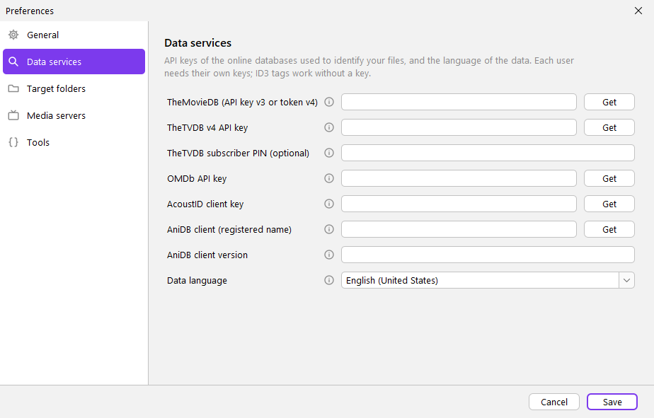

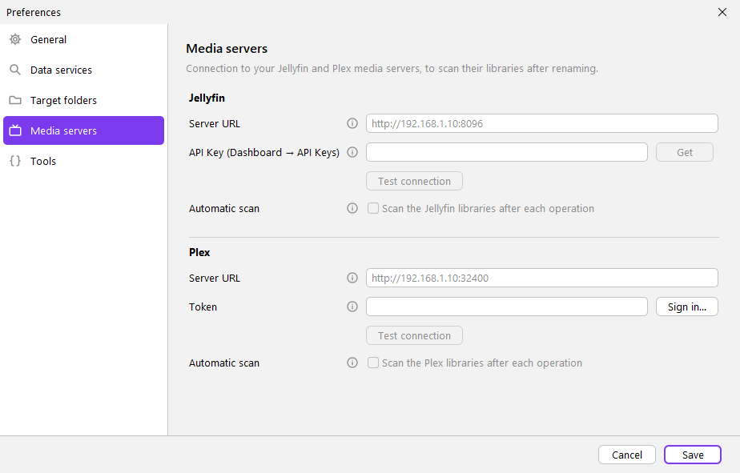

## Interface language

In **Preferences → General → Interface language** you can choose *Automatic* (the system language; English if it
is not one of the available ones), English, Español, Français, Deutsch, Português or Italiano. After saving, the
following dialogs already use the new language and the application asks whether to **reload the window** right
away: the file list is kept, but the data has to be fetched again. If you answer no, it applies the next time
MediaRenamer is opened. Do not confuse it with the *data language* (titles, overviews), which is chosen in
*Fetch data* or in *Data and tools*.

## Fixing before renaming

| I need… | How |
|---|---|
| Another movie or series for some files | Select them and press **Manual search** (also in the context menu). If none is selected, the unidentified ones are used. It shows posters and, on mouse hover, the full details |
| Another episode for a row | Select the row and press **Episode** (or right click → *Choose episode…*). Filter by number (`1x02`, `S01E02`, `12`) or by title. Ctrl/Shift + click selects several for a file with two episodes |
| Moving the match of one row to another | **Drag** the name in *Target files* to its correct position. The other matches shift and the original files do not move |
| Changing only the name of a row | Double click the new name, or right click → *Edit name* |
| Removing the match of a row | Right click → *Clear match* |
| Seeing the format variables of a row | **Bindings** (or right click → *Show bindings*) |
| Changing the format | **Format** opens the editor with live preview. The **ⓘ Variables** link (top right) lists every variable by group and the common methods in its tooltip; clicking it shows the value of each variable for the sample file |

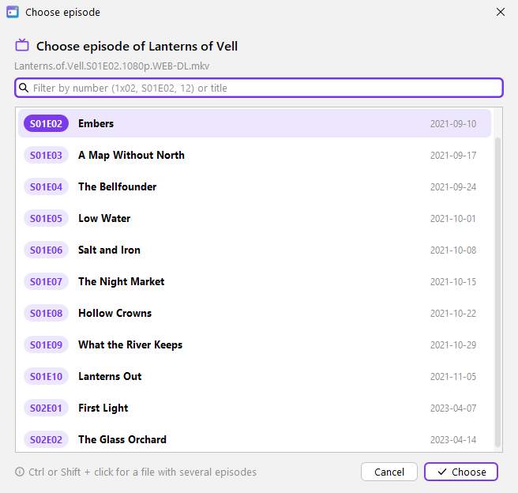

## Profiles

**Profiles → Edit profiles…** creates, edits and deletes profiles: name, target folder, format, data source, episode
order, matching mode, language, action and the Jellyfin/Plex scans (*(don't change)* = the current or Preferences
option is used).

- **Format → Editor…** opens the same format editor as the main window, with live preview, starting from the
  profile's format. Its mode is fixed by the profile's data source (TheMovieDB → Movies, TheMovieDB::TV → Series,
  *file* → File…), with a sample file of that mode. **Use format** copies the result to the profile.
- **Language** is the same searchable list as in Preferences; its first entry is *(don't change)*.
- **New** adds an untitled profile to the list. It is not stored until you save it.
- **Unsaved changes** are kept while you move from one profile to another. A profile with changes is shown in orange
  with a dot, and **Save** stores all of them at once (a profile without a name or format is shown and nothing is
  saved). Closing (Close, Esc or ✕) with unsaved changes asks: **Save**, **Discard** or **Cancel**.

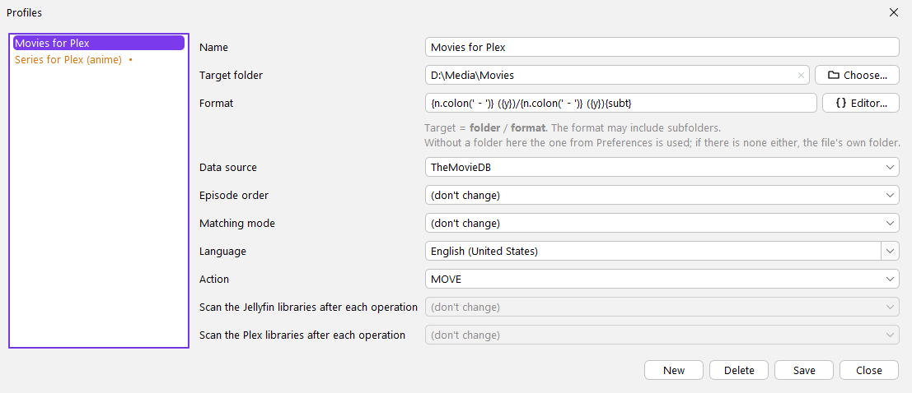

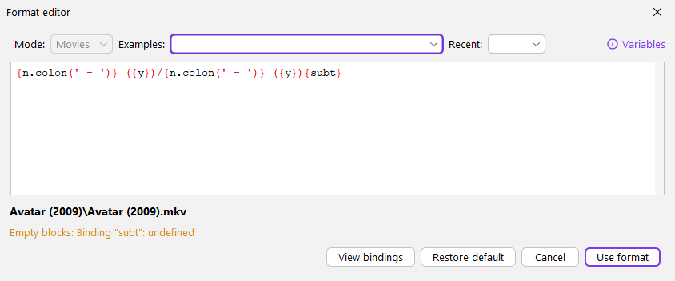

## Name pre-check

When **Apply** is pressed the new names are checked. If something is wrong the check dialog appears, with
a suggested clean name for each case:

| Type | Examples | Suggestion |
|---|---|---|
| **Error** (the rename would fail) | characters not allowed on Windows `: ? * < > \| "`, reserved names (`CON`, `NUL`, `COM1`…), ending with a dot or a space, names longer than 255 characters | `:` → ` - `; the others are removed; `CON` → `CON_`; trailing dots and spaces are trimmed; shortened keeping the extension |
| **Warning** | emojis and symbols, odd or invisible spaces, homoglyphs of forbidden characters (`∶` `⁄` `？`), double spaces, paths longer than 259 characters, two files with the same target | they are cleaned (**accents and ñ are kept**); ` (1)` is added to the duplicate |

Options: **Clean up and rename** (uses the suggestions), **Rename without changes** or **Back**.

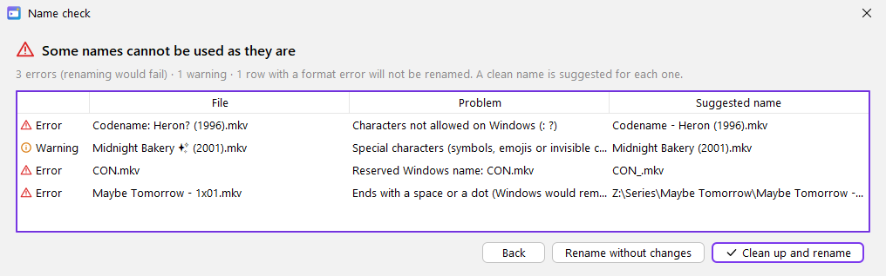

## If the target already exists

Default option: **Ask each time**. It shows both files with their quality (resolution, codec, HDR,
bitrate, audio, duration) and size, and lets you keep the existing one, replace it, keep both
or cancel everything, with the option *Do the same for the remaining conflicts*. The other options are described in
[CLI.md](CLI.md#if-the-target-already-exists---conflict).

Two files of the list that end up with the same target never replace each other, whatever the option: the second one
is reported as an error and stays untouched (the name pre-check already warns about it). *Replace* sends the existing
file to the recycle bin; where there is none (network drives), it is deleted permanently and the status bar says so.

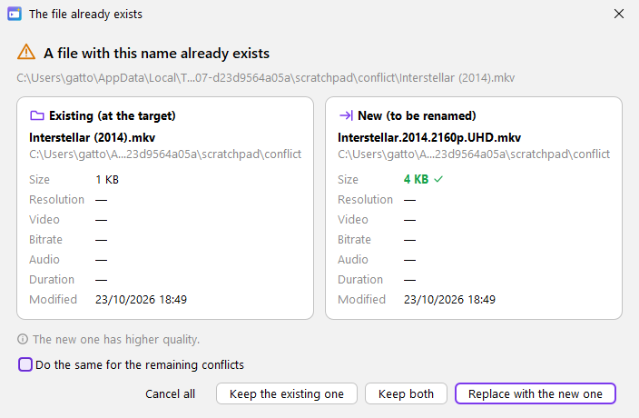

## History

**History** (header) lists every renamed file in a single table, most recent first: **Date**, **Source** (the
original path) and **Target** (the new path). It shows 50 rows per page; the buttons « ‹ › » at the bottom left
move between pages, next to *Page n of N · total renames*.

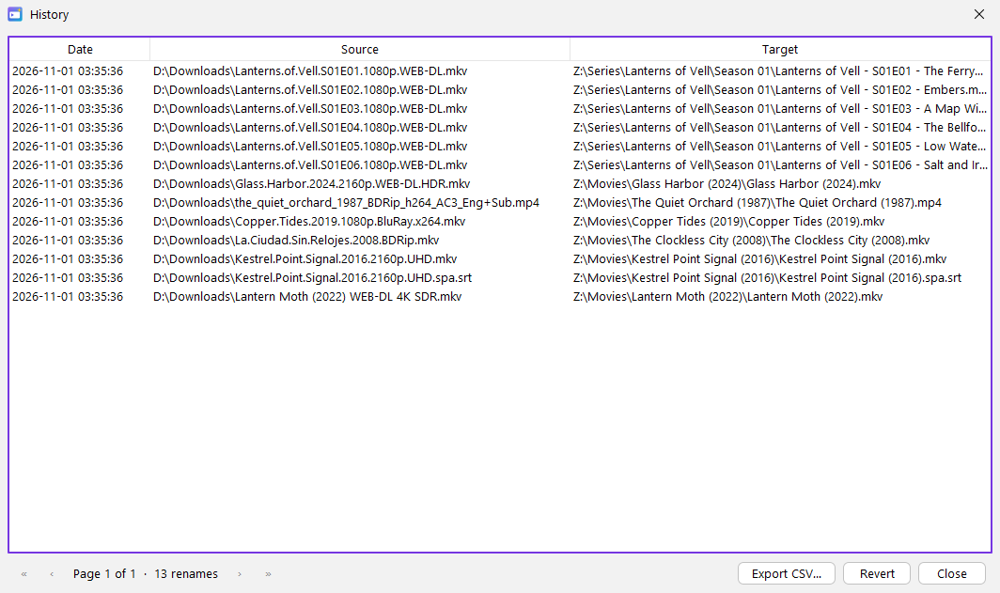

- **Revert**: select one or more rows (Ctrl/Shift + click) and press it to move those files back to their original
  name and folder.
- **Export CSV…**: saves the whole history (all pages) to a `.csv` file with the columns Date, Source, Target
  (UTF-8, comma separator; it opens directly in Excel).

## About MediaRenamer

The discreet **ⓘ** button at the top right (or a click on the version at the bottom right) opens *About MediaRenamer*:
version, author (AeLiu), "Powered by Claude Code", Java version,
data folder (with a button to open it), libraries and the notices of the data services.

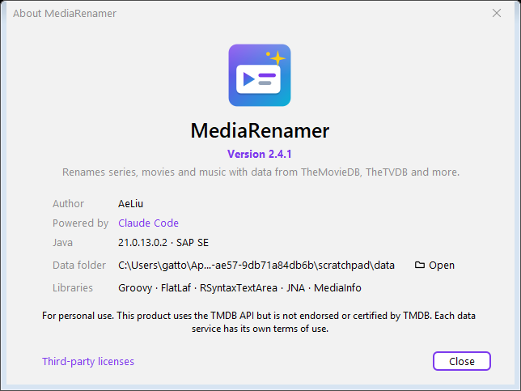

## Where the files are placed

Target = `<folder>/<format>`, with the original extension added automatically. The folder is:

1. the one of the active **profile** (*Profile: …* chip at the bottom right; click it to stop using it),
2. if it has none, the one from **Preferences** for that type (Movies, Series, Anime, Music, Other),
3. if there is none either, the **file's own folder**.

The format can create subfolders (`{ny}/{n} - {sxe} - {t}`). If the format is already a full path, it is used as is.
